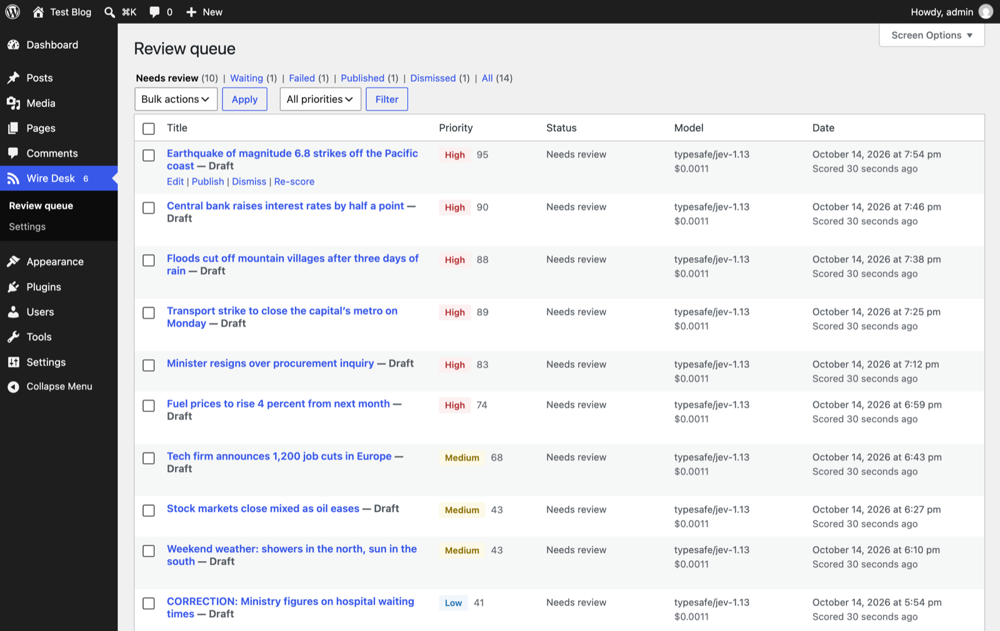
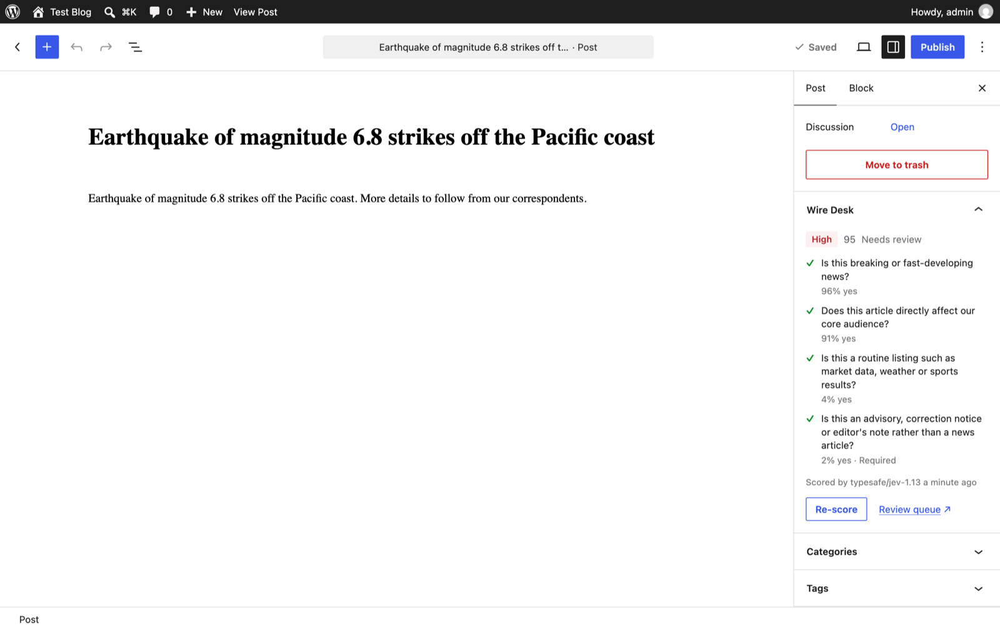
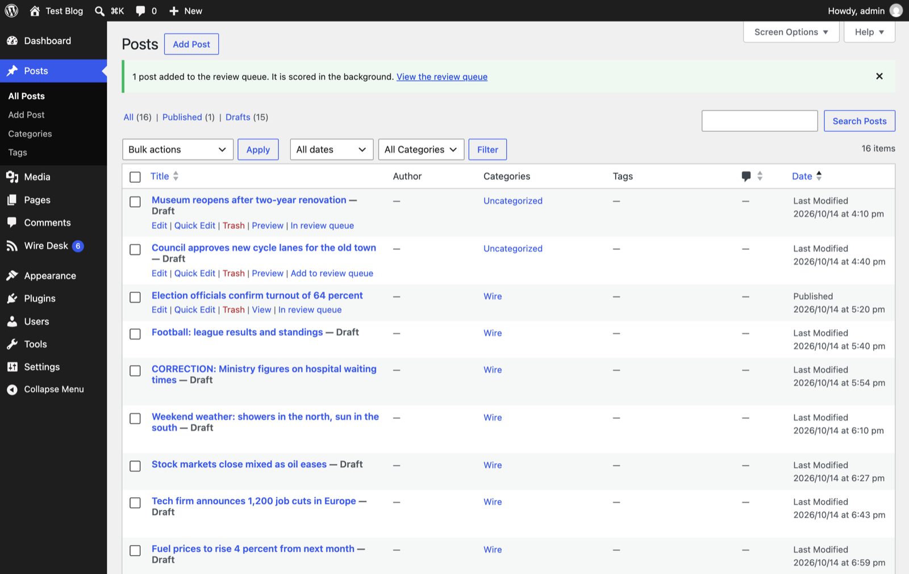
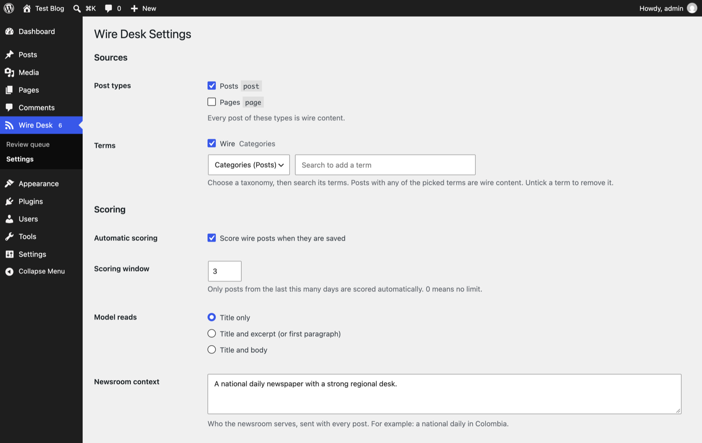
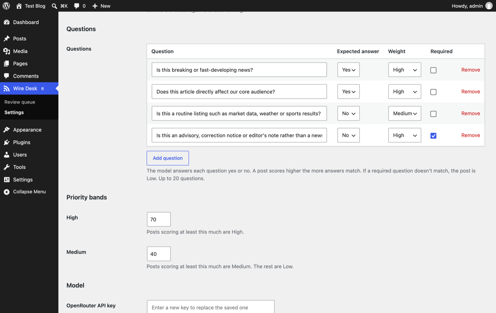
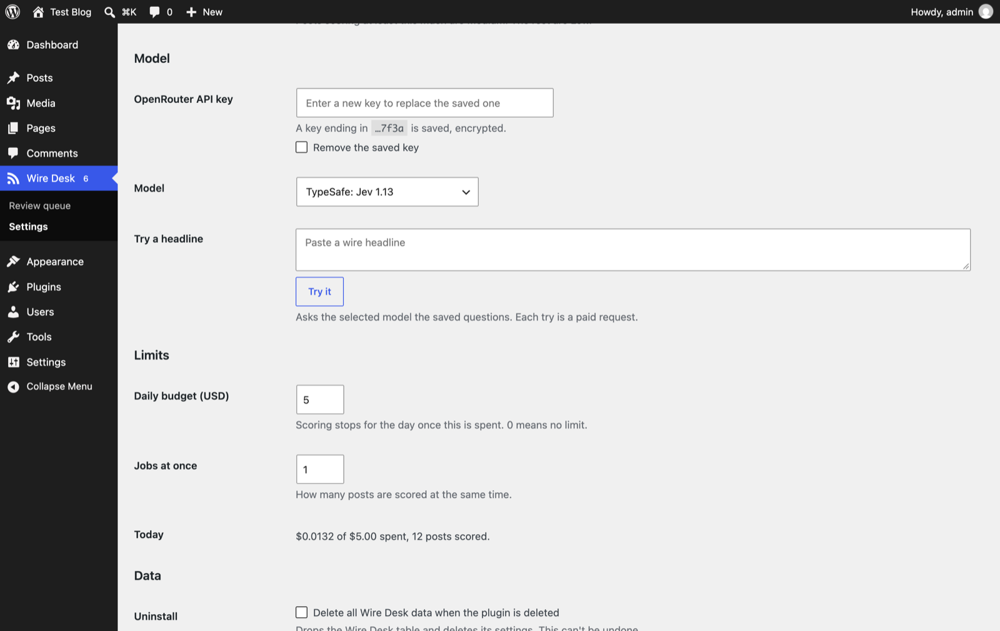

# Wire Desk

[](LICENSE.md)
[](composer.json)
[](https://wordpress.org)

---

Wire Desk helps high-volume newsrooms triage wire-ingested posts. It asks a decision model a set of configurable yes/no questions about each incoming post, scores it, and gives editors a review queue to decide what gets published.

> [!IMPORTANT]
> Wire Desk sends the parts of each post you choose (the headline by default) to a third-party decision model through OpenRouter, using your own API key. You are responsible for making sure your wire agency agreements and data policies allow this. Wire Desk only suggests priorities; editors always decide what gets published.

## Screenshots

### Review queue

Wire posts waiting for an editor, newest first, with a filter for each priority. The menu badge counts High posts that need review. Each post can be published, dismissed or re-scored from its row, or in bulk.



### Wire Desk panel in the editor

The score behind a post: each question, whether the model's answer met it, and how sure it was. Re-score from the sidebar after editing.



### Adding existing posts

Posts saved before you set Wire Desk up can be added from the post list, one at a time or with the bulk action.



### Choosing what counts as wire content

Pick whole post types, or terms from any taxonomy, including custom ones.



### Questions and priority bands

The yes/no questions the model answers, how much each one counts, and the scores that make a post High or Medium. A post that misses a required question is always Low.



### API key, model and limits

Save the OpenRouter key encrypted, pick a decision model, try a headline, and cap daily spend.



## Documentation

- **[Development Guide](docs/DEVELOPMENT.md)** - Local setup, commands, testing, and contribution guidelines.

**Reference:**
[Action Hooks](docs/reference/actions.md) | [Filter Hooks](docs/reference/filters.md) | [Constants](docs/reference/constants.md) | [WP-CLI Commands](docs/reference/cli.md) | [REST API](docs/reference/rest.md)

## Project Structure

```
├── .github/workflows/      # CI/CD workflows (call the skeleton's reusable workflows)
├── docs/                   # Development guides and references
├── inc/                    # Plugin-specific PHP source
├── framework/              # Reusable framework (shared with the skeleton)
│   └── README.md
├── src/                    # TypeScript/JS entry points
│   └── README.md
├── templates/              # PHP templates with theme override support
└── tests/                  # PHPUnit tests
```

See [./docs/DEVELOPMENT.md](docs/DEVELOPMENT.md#directory-structure) for a detailed directory tree and descriptions.

## License

GPL-3.0-or-later. See [LICENSE.md](LICENSE.md).
